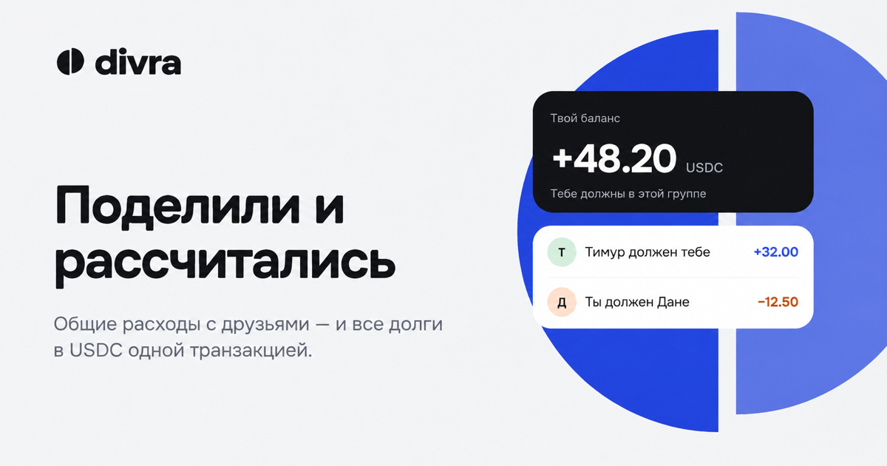

# Divra

**English** · [Русский](README.ru.md)



Divra is a shared wallet for groups of friends. You split expenses like in Splitwise, and debts are settled with a stablecoin
(USDC or USDT) on Solana: one transaction, straight from wallet to wallet, with no middleman. Divra never holds money or
private keys. The backend builds the transactions, finds them on-chain and verifies them before marking a debt as paid.

This is a full-stack portfolio project: a React web app and a NestJS API in one monorepo. I designed and built it
alone, from product idea and UI to the backend, on-chain integration and tests.

## Highlights

- **Passwordless sign-in with a wallet.** The user signs a challenge with Phantom or Solflare and gets a JWT. The access
  token lives only in memory, the refresh token sits in an HttpOnly cookie, and refresh tokens rotate with reuse
  detection.
- **Real on-chain payments.** "Request" creates a Solana Pay link and QR code. "Settle up" pays all of a user's debts in
  a single transaction. A payment counts only after the server has found the transfer on-chain and checked the amount,
  token and recipient.
- **Transfers made outside the app.** A Helius LaserStream (Geyser gRPC) subscription watches the token accounts of
  Divra users. When one member sends USDC to another they owe, the recipient sees a "count it toward the debt?" card.
  The server re-verifies the transaction over RPC before applying it.
- **Real-time UI.** Domain events go to the browser over socket.io (with an Origin check and the token sent in the
  handshake). The frontend invalidates TanStack Query caches, so every open screen updates without a reload.
- **Debt maths done right.** Expenses can be split equally, by exact amounts, by percentages or by shares, with no
  rounding leftovers. Debts are netted out per group into "who pays whom", and amounts are shown in ₸, ₽ or $.
- **Everyday features:**
  - editing and deleting expenses;
  - members without a wallet;
  - invite links you can revoke;
  - reminders, limited to one a day;
  - cash repayments;
  - leaving a group;
  - deleting your account.
- **History with infinite scroll.** On-chain transfers and payments are merged into one list with cursor pagination.

## Tech stack

| Layer | Technologies |
| --- | --- |
| Frontend | React 19 (React Compiler), TypeScript, Vite, React Router, TanStack Query, Zustand, Zod, socket.io-client |
| Solana | `@solana/kit`, Wallet Standard (Phantom, Solflare), Solana Pay, SPL Token, Helius LaserStream (gRPC) |
| Backend | NestJS 12, Drizzle ORM, PostgreSQL 17, Zod validation, socket.io, Helmet, rate limiting |
| Quality | Vitest, Testing Library, Playwright, PGlite for backend e2e, oxlint, Steiger (FSD linter), Lefthook, Commitlint |

## Architecture

```
┌────────────┐  REST + WebSocket   ┌──────────────┐     ┌────────────┐
│  frontend  │ ◄─────────────────► │   backend    │ ──► │ PostgreSQL │
│  React     │                     │   NestJS     │     └────────────┘
└─────┬──────┘                     └──┬────────▲──┘
      │ signs and sends               │ RPC:   │ gRPC stream
      │ transactions                  │ verify │ (Helius LaserStream)
      ▼                               ▼        │
┌─────────────────────────────────────────────┴──┐
│                 Solana (devnet)                │
└────────────────────────────────────────────────┘
```

- The **frontend** follows Feature-Sliced Design, and Steiger enforces the layer rules. The Zod schemas in
  `shared/api` are the contract with the backend. A built-in mock backend runs in the browser, so the app works
  without a server and is useful for UI work.
- The **backend** is split into modules: auth, groups, invites, payments and transfers. Money logic runs in database
  transactions with row locks. Unique indexes make payments idempotent, so the same transfer can never be counted
  twice.
- Each design decision is written down with its reasoning: [frontend](frontend/docs/ARCHITECTURE.md) (48 decisions)
  and [backend](backend/docs/ARCHITECTURE.md) (40 decisions).

## Testing

- **Frontend:** 85 unit and component tests, plus Playwright end-to-end tests.
- **Backend:** 30 unit tests and 112 e2e tests. The e2e tests run the real app against an in-memory PostgreSQL
  (PGlite), and a fake stream replaces the gRPC feed, so no test needs the network.
- **Git hooks:** linting, the FSD architecture check and conventional commits run on every commit.

## Running locally

You need Node.js 24, Docker, and a Phantom or Solflare wallet switched to **devnet**.

```bash
# backend: API on http://localhost:3000/api
cd backend
cp .env.example .env              # set JWT_SECRET: openssl rand -base64 48
docker compose up -d              # PostgreSQL
npm install && npm run db:migrate && npm run start:dev

# frontend: http://localhost:5173
cd ../frontend
cp .env.example .env.local        # VITE_API_MOCK=true runs it with no backend at all
npm install && npm run dev
```

Test tokens: devnet USDC from [faucet.circle.com](https://faucet.circle.com), SOL for fees from
[faucet.solana.com](https://faucet.solana.com). Detecting outside transfers is optional and needs a
[Helius](https://dashboard.helius.dev) key in `HELIUS_API_KEY`.

The [frontend](frontend/README.md) and [backend](backend/README.md) READMEs cover setup, environment variables and the
full API.

## Project status

This is an MVP that runs on Solana devnet. Known limitations:

- The transfer stream runs in a single backend process. Running several replicas would need a leader lock and the Redis
  adapter for socket.io.
- Exchange rates for ₸, ₽ and $ still come from the frontend mock.
- USDT can only be tested on mainnet, because Tether has no devnet token.

## Author

Adil Khojabergenov, Senior Frontend / Full-stack Engineer (React, TypeScript, Node.js, Solana).

[LinkedIn](https://www.linkedin.com/in/adil-khojabergenov) · [GitHub](https://github.com/Proadik)
