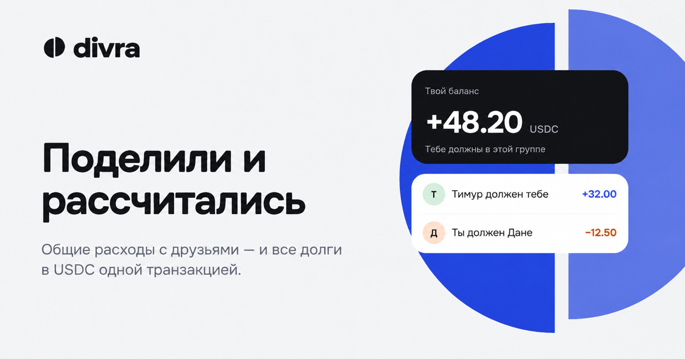

# Divra

[English](README.md) · **Русский**



Divra — общий кошелёк для компании друзей. Расходы делятся как в Splitwise. Долги закрываются переводом стейблкоина
(USDC или USDT) в сети Solana: одной транзакцией, напрямую с кошелька на кошелёк, без посредника. Divra не хранит ни
деньги, ни ключи. Бэкенд собирает транзакции, находит их в сети и засчитывает оплату только после проверки.

Это full-stack проект для портфолио: веб-приложение на React и API на NestJS в одном монорепозитории. Я сделал его
один, от идеи и интерфейса до бэкенда, интеграции с блокчейном и тестов.

## Что интересного

- **Вход без пароля, через кошелёк.** Пользователь подписывает вызов в Phantom или Solflare и получает JWT.
  Access-токен хранится только в памяти, refresh-токен — в HttpOnly-cookie. Refresh-токены ротируются, и повторное
  использование старого токена распознаётся.
- **Настоящие платежи в сети.** «Запросить» создаёт ссылку и QR-код Solana Pay. «Рассчитаться» оплачивает все долги
  пользователя одной транзакцией. Оплата засчитывается только после того, как сервер сам нашёл перевод в сети и
  проверил сумму, токен и получателя.
- **Переводы в обход приложения.** Подписка Helius LaserStream (Geyser gRPC) следит за токен-аккаунтами
  пользователей Divra. Если участник отправил USDC тому, кому должен, получатель видит карточку «засчитать в долг?».
  Перед зачётом сервер заново проверяет транзакцию через RPC.
- **Интерфейс в реальном времени.** События сервера приходят в браузер через socket.io. При подключении проверяется
  Origin, а токен передаётся в handshake. Фронтенд сбрасывает кэши TanStack Query, и все открытые экраны обновляются
  без перезагрузки.
- **Корректный расчёт долгов.**
  - Деление поровну, точными суммами, в процентах или долями.
  - Копейки не теряются при округлении.
  - Долги внутри группы взаимно зачитываются в итог «кто кому».
  - Суммы показываются в ₸, ₽ или $.
- **Всё, что нужно в быту:**
  - правка и удаление расходов;
  - участники без кошелька;
  - ссылки-приглашения с отзывом;
  - напоминания (не чаще раза в сутки);
  - возврат наличными;
  - выход из группы;
  - удаление аккаунта.
- **История с бесконечной прокруткой.** Переводы в сети и засчитанные оплаты собраны в одну ленту с курсорной
  пагинацией.

## Технологии

| Слой | Технологии |
| --- | --- |
| Фронтенд | React 19 (React Compiler), TypeScript, Vite, React Router, TanStack Query, Zustand, Zod, socket.io-client |
| Solana | `@solana/kit`, Wallet Standard (Phantom, Solflare), Solana Pay, SPL Token, Helius LaserStream (gRPC) |
| Бэкенд | NestJS 12, Drizzle ORM, PostgreSQL 17, валидация через Zod, socket.io, Helmet, ограничение частоты запросов |
| Качество | Vitest, Testing Library, Playwright, PGlite для e2e бэкенда, oxlint, Steiger (линтер FSD), Lefthook, Commitlint |

## Архитектура

```
┌────────────┐  REST + WebSocket   ┌──────────────┐     ┌────────────┐
│  frontend  │ ◄─────────────────► │   backend    │ ──► │ PostgreSQL │
│  React     │                     │   NestJS     │     └────────────┘
└─────┬──────┘                     └──┬────────▲──┘
      │ подписывает и                 │ RPC:   │ gRPC-поток
      │ отправляет транзакции         │ сверка │ (Helius LaserStream)
      ▼                               ▼        │
┌─────────────────────────────────────────────┴──┐
│                 Solana (devnet)                │
└────────────────────────────────────────────────┘
```

- **Фронтенд** построен по Feature-Sliced Design, правила слоёв проверяет Steiger. Zod-схемы в `shared/api` служат
  контрактом с бэкендом. Встроенный мок-бэкенд работает прямо в браузере, поэтому приложение запускается и без сервера.
  Это удобно для работы над интерфейсом.
- **Бэкенд** разделён на модули: auth, groups, invites, payments, transfers. Всё, что касается денег, выполняется в
  транзакциях БД с блокировкой строк. Уникальные индексы делают зачёт оплат идемпотентным: один и тот же перевод
  нельзя засчитать дважды.
- Каждое архитектурное решение описано вместе с причинами: [фронтенд](frontend/docs/ARCHITECTURE.md)
  (48 решений) и [бэкенд](backend/docs/ARCHITECTURE.md) (40 решений).

## Тесты

- **Фронтенд:** 85 unit- и компонентных тестов, e2e на Playwright.
- **Бэкенд:** 30 unit-тестов и 112 e2e-тестов. E2E поднимают настоящее приложение с PostgreSQL в памяти (PGlite).
  Вместо gRPC-потока работает фейковый поток, поэтому тесты не ходят в сеть.
- **Git-хуки:** на каждый коммит проверяются линтер, архитектура FSD и формат сообщения (conventional commits).

## Запуск

Нужны Node.js 24, Docker и кошелёк Phantom или Solflare, переключённый на **devnet**.

```bash
# бэкенд: API на http://localhost:3000/api
cd backend
cp .env.example .env              # задай JWT_SECRET: openssl rand -base64 48
docker compose up -d              # PostgreSQL
npm install && npm run db:migrate && npm run start:dev

# фронтенд: http://localhost:5173
cd ../frontend
cp .env.example .env.local        # с VITE_API_MOCK=true работает вообще без бэкенда
npm install && npm run dev
```

Тестовые монеты: devnet USDC выдаёт [faucet.circle.com](https://faucet.circle.com), SOL на комиссии —
[faucet.solana.com](https://faucet.solana.com). Распознавание переводов в обход приложения необязательно; для него
нужен ключ [Helius](https://dashboard.helius.dev) в `HELIUS_API_KEY`.

Подробная настройка, переменные окружения и полное описание API — в README [фронтенда](frontend/README.md) и
[бэкенда](backend/README.md).

## Статус

Это MVP, он работает в Solana devnet. Известные ограничения:

- Поток переводов работает в одном процессе бэкенда. Чтобы запустить несколько реплик, нужна блокировка лидера и
  Redis-адаптер для socket.io.
- Курсы ₸, ₽ и $ пока берутся из мока на фронтенде.
- USDT можно проверить только в mainnet: у Tether нет devnet-токена.

## Автор

Adil Khojabergenov — Senior Frontend / Full-stack Engineer (React, TypeScript, Node.js, Solana).

[LinkedIn](https://www.linkedin.com/in/adil-khojabergenov) · [GitHub](https://github.com/Proadik)
